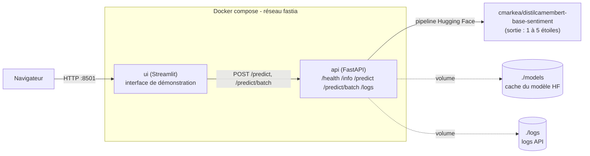

# Escale Atlantique — Sentiment des avis clients

Projet FastIA (brief M0-B2) : classer les avis clients d'une chaîne d'hôtels en **négatif, neutre ou positif**, pour que le service qualité traite les clients mécontents en priorité sans avoir à tout relire.

## Contexte

Le service qualité d'Escale Atlantique reçoit plusieurs centaines d'avis clients par mois et ne parvient plus à tous les lire. Le modèle utilisé, [`cmarkea/distilcamembert-base-sentiment`](https://huggingface.co/cmarkea/distilcamembert-base-sentiment), prédit une note de **1 à 5 étoiles** : la conversion en 3 classes métier (négatif/neutre/positif) est faite par l'API.

## Architecture



- **`api`** (FastAPI) : charge le modèle une seule fois au démarrage (`lifespan`), expose `/predict` (texte → sentiment), `/health`, `/info`, `/logs` (traçabilité des dernières prédictions).
- **`ui`** (Streamlit) : interface de démonstration, appelle l'API via `API_URL`, journalise chaque appel (succès et erreurs) dans `logs/ui.log`.
- Le modèle est mis en cache sur le volume `./models` : téléchargé une fois, puis tout fonctionne hors ligne.

## Structure

```
docker-compose.yml     # 2 services (api, ui), réseau interne, volumes, healthcheck
.env.example           # variables d'environnement, à copier en .env
api/
  app/main.py          #   lifespan (chargement du modèle), /health, /info, /predict, /logs
  app/inference.py     #   chargement du pipeline + conversion étoiles -> sentiment
  app/journal.py       #   traçabilité des prédictions (pour /logs)
  app/schemas.py       #   schémas Pydantic
  scripts/evaluer.py   #   évaluation du modèle sur les avis annotés (tâche 6)
  scripts/evaluer.ipynb#   la même évaluation, en notebook
  tests/                #   tests unitaires (conversion, logs, predict, health)
  Dockerfile
ui/                    # service Streamlit
  app.py
  journal.py           #   traçabilité des appels à l'API côté interface (logs/ui.log)
  Dockerfile
data/
  avis_annotes.csv     # 30 avis annotés par l'équipe qualité
postman/
  escale_atlantique.postman_collection.json  # cas limites : vide, trop long, emojis, ironie
analyse_erreurs.md     # analyse d'avis mal classés (tâche 7)
models/                # cache du modèle Hugging Face (volume, non versionné)
logs/                  # logs api.log + ui.log (volume, non versionné, créé au lancement)
```

## Installation et lancement

### Prérequis

- [Docker Desktop](https://www.docker.com/products/docker-desktop/) installé et démarré (inclut `docker compose`).
- Les ports **8000** (API) et **8501** (interface) libres sur la machine.
- Une connexion internet au premier lancement (téléchargement du modèle, ≈ 270 Mo) — tout fonctionne hors ligne ensuite.

### Avec Docker (recommandé)

```bash
cp .env.example .env
docker compose up --build
```

⏳ Le premier lancement télécharge le modèle : compte quelques minutes. Les lancements suivants sont rapides.

- API : http://localhost:8000/health et http://localhost:8000/docs
- Interface : http://localhost:8501
- État des services : `docker compose ps` (l'API doit être *healthy*)
- Arrêt : `docker compose down`

### Sans Docker (dépannage)

Si Docker n'est pas disponible, chaque service tourne aussi directement en Python 3.12 — **dans deux terminaux séparés**, l'API doit être lancée avant l'UI.

**API** (dépendances dans `api/requirements.txt`, torch CPU inclus) :

```bash
cd api
pip install -r requirements.txt
uvicorn app.main:app --host 127.0.0.1 --port 8000
```

**UI** (dépendances dans `ui/requirements.txt`) :

```bash
cd ui
pip install -r requirements.txt
API_URL=http://127.0.0.1:8000 streamlit run app.py   # bash/macOS/Linux
```

```powershell
cd ui
pip install -r requirements.txt
$env:API_URL = "http://127.0.0.1:8000"; streamlit run app.py   # PowerShell
```

⚠️ Sans Docker, `API_URL` doit pointer sur `http://127.0.0.1:8000` (pas `http://api:8000`, qui n'existe que dans le réseau docker compose) — c'est d'ailleurs déjà la valeur par défaut dans `ui/app.py` si la variable n'est pas définie, donc cette étape est optionnelle en local.

### Tests

```bash
docker compose exec api pytest -v
# ou, sans Docker :
cd api && pytest -v
```
